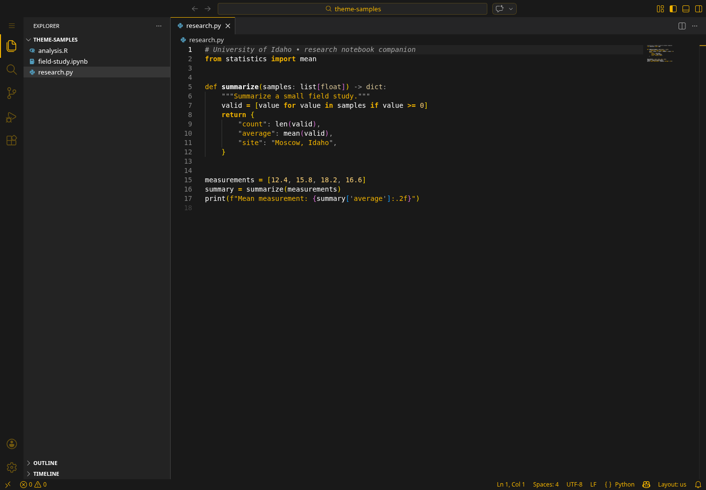
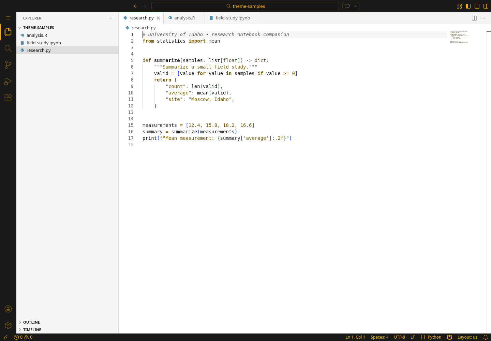
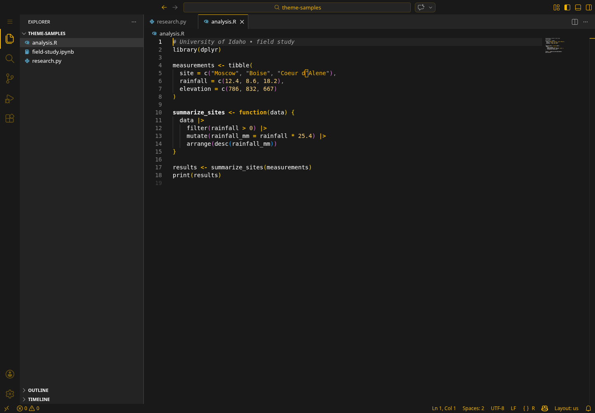
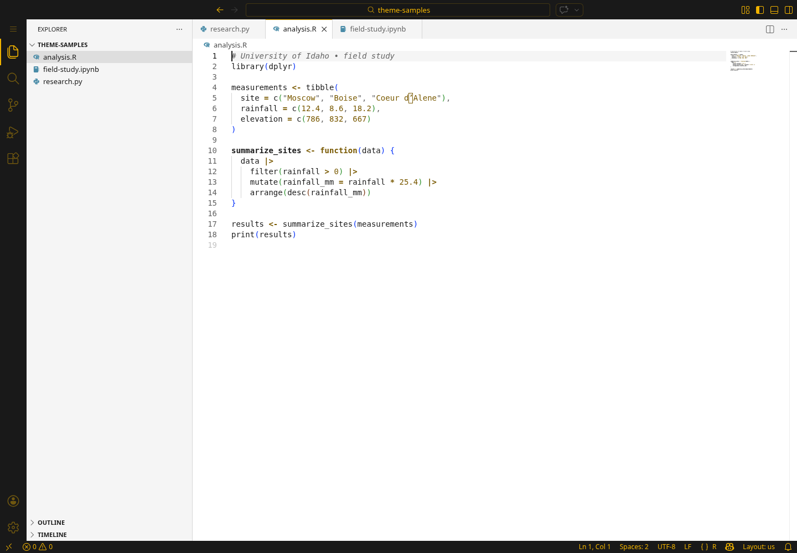
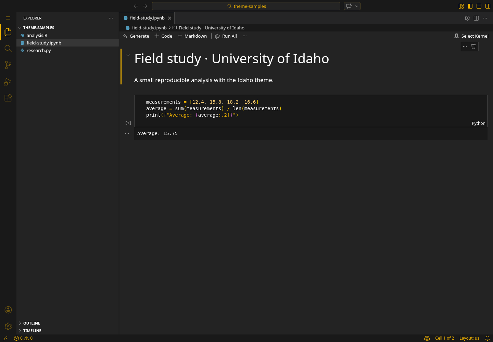
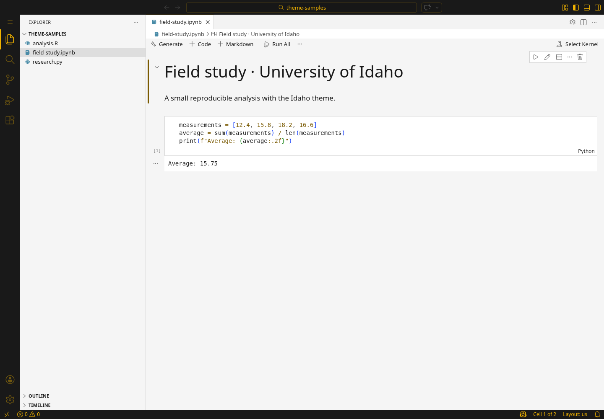

# University of Idaho Theme


University of Idaho-inspired dark and light color themes for **Positron** and **Visual Studio Code**. Bring black-and-gold accents to your editor, terminal, and syntax highlighting.

## Included themes

| Theme | Appearance |
| --- | --- |
| University of Idaho — Black & Gold | Dark background with gold accents and syntax highlighting. |
| University of Idaho — Dual Gold/White/Black | White editor background with dark text and gold accents. |

## Install in Positron

1. Open the **Extensions** view and search for **University of Idaho Theme**.
2. If the extension is available in your configured registry, select **Install**.
3. Otherwise, obtain a `.vsix` package from this repository or build one locally. Open the Command Palette, run **Extensions: Install from VSIX...**, and select the package.
4. Run **Preferences: Color Theme** and choose one of the two theme names above.

Installing a VSIX makes the extension available locally; it does not publish the extension to Positron’s registry. The theme includes explicit Positron console, Variables, and data viewer colors. These settings are matched to registered Positron color identifiers; visual verification in the Positron desktop app is still pending. Color identifiers were checked against [Positron source](https://github.com/posit-dev/positron/blob/947beb2aa196beb9f800022cca7c74ae4fe5e5ec/src/vs/workbench/common/theme.ts).

## Install in Visual Studio Code

Open the **Extensions** view, search for **University of Idaho Theme**, and select **Install**. You can also use **Extensions: Install from VSIX...** to install a local package.

Run **Preferences: Color Theme** from the Command Palette to switch between the dark and light variants.

## Color direction

Both themes now use this core palette:

| Color | Hex |
| --- | --- |
| Gold | `#F1B300` |
| Gray | `#808080` |
| Charcoal | `#191919` |
| White | `#FFFFFF` |

Brand reference: [University of Idaho brand guide](https://www.uidaho.edu/brand).

Gold marks focus and active controls; charcoal and white provide editor backgrounds. Gray and related neutral shades define secondary surfaces. The light theme uses a darker gold-derived color for readable syntax and links. Red, green, blue, cyan, and purple remain available for diagnostics, Git changes, and terminal output. A metallic gold value has not been confirmed and is not included.

## What is styled

- Editor, terminal, autocomplete, hover cards, search matches, selections, and focus indicators.
- Git decorations and diffs, with distinct added, modified, and deleted colors.
- Errors, warnings, and informational messages with recognizable status colors.
- Notebook cells, borders, outputs, and insertion indicators.
- Positron console (including ANSI output), Variables pane, data grid, and data explorer.
- TextMate syntax and semantic tokens, with readable text contrast in both variants.

## Screenshots

These are real captures from OpenVSCode Server using the installed theme, not Positron desktop captures. Python and R samples illustrate syntax highlighting; the notebook includes saved output and does not require an active kernel. Sample files are in [examples](examples).

| Python — dark | Python — light |
| --- | --- |
|  |  |

| R — dark | R — light |
| --- | --- |
|  |  |

| Notebook — dark | Notebook — light |
| --- | --- |
|  |  |

## Development

Run `npm test` with Node.js 22 or newer. No project dependencies are required. The validator checks theme registration, JSON values, the PNG icon, and a minimum 4.5:1 contrast ratio for syntax and core text/background pairs. It does not certify every UI state or text drawn by third-party extensions.

Package with `vsce package --no-dependencies` using `@vscode/vsce` 4.1.0. The original mountain-and-code icon is AI-generated artwork for this extension, not an official university logo. Theme names are preserved so existing editor preferences continue to work.

## Customize

In Positron or VS Code, open **Preferences: Open User Settings (JSON)** and add overrides such as:

```json
{
  "workbench.colorCustomizations": {
    "[University of Idaho — Black & Gold]": {
      "editor.background": "#191919",
      "editorCursor.foreground": "#F1B300",
      "focusBorder": "#F1B300"
    }
  }
}
```

Use `editor.tokenColorCustomizations` to adjust syntax highlighting separately.

## Feedback

[Report an issue or request an improvement](https://github.com/justicekessie/university-of-idaho-theme/issues). For color or readability issues, include your editor version, selected theme, language, and a screenshot without private information.

## License

[MIT](LICENSE). This project is inspired by the University of Idaho; it does not claim university endorsement.

Go Vandals!
